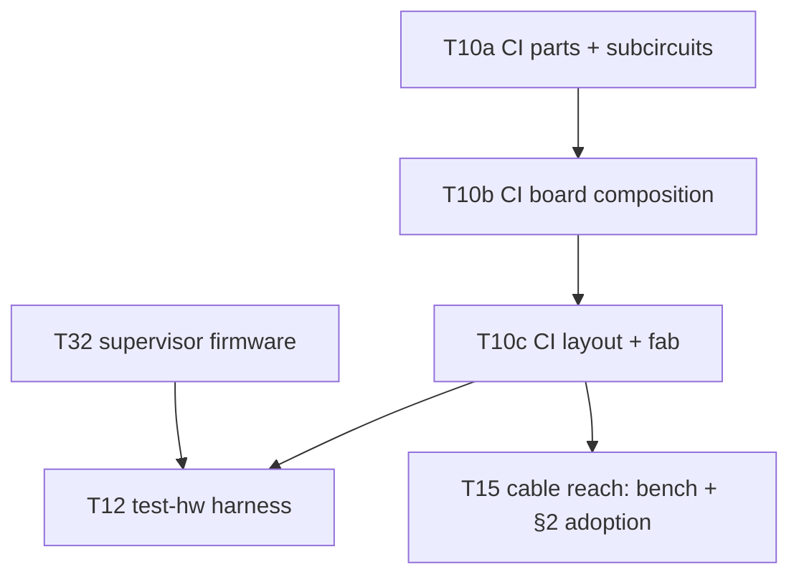

# KANBAN

The **single home for planned work** — the execution view over oparroy's
planning. Each card carries its own description; IDEAS.md is the
not-yet-ready stash, and DESIGN.md holds settled design decisions and
open design questions. When ordering matters, KANBAN wins.

Dormant in spirit until the project opens up, but cards are written in
final form from day one so pickup works the same then as now.

Each card is a **vertical slice** — thin end-to-end through the layers it
touches (DSL → firmware → board → test), completable as one change.
Cards that aren't slices (a DESIGN decision, research, a chore) carry a
**`Shape:`** tag so the picker knows.

## How to pick up work

1. Take the top card in **Next** that fits your context. Next is the set
   of cards with no unbuilt blockers; within Next, higher = higher
   leverage.
1. The change that ships a card **deletes the card** from this file —
   shipped cards are dropped, not moved into a Done column (git history
   is the durable archive). There is no In Progress column either.
1. On shipping, promote any newly-unblocked Backlog card into **Next**.

**If a card grows beyond one change, split it first** (T##a, T##b, …).
Never leave a card half-landed.

## Dependency graph

Critical paths only — every card also carries its own
`Blocked by:`/`Unblocks:`.

______________________________________________________________________

## Next

- **T10a — CI board parts + instrumentation subcircuits.** Split from
  T10. The capture-side building blocks the CI board composes: typed
  parts and parts-DB entries for the scan plane (SN74HC595 control,
  SN74HC165 observe — datasheets vendored), the AO3401A-class
  power-cut P-FET and the 2N7002-class override N-FETs, and the
  demonstrator I/O complement (potentiometer, buttons, buzzer) —
  inventory-driven (DESIGN.md §6), datasheet extraction per the
  standing rule. Then the subcircuit captures,
  each consuming the instrumentation-transform machinery with
  provenance tags: the four-state segment injector (three
  SN74LVC1G3157 + 470 Ω shunt legs, docs/instrumented-ci.md §2), the
  per-tile power cut with the 3V3/3V3N rail split (§3), the
  keep-alive cut (§4), the human-I/O overrides (§6), the per-tile
  scan slice plus the supervisor aux stages (docs/scan-plane.md
  §2-3), and the ganged SWIO/debug 3157 trees (§5). The supervisor
  pin map (`design/supervisor_pins.py`) gains the four pot-override
  PWM channels — one per input tile, never allocated when the
  subcircuit landed.
  **Blocked by:** — · **Unblocks:** T10b
- **T34 — CI board block diagram.** *Shape: docs.* One page showing
  the whole CI board as blocks and the wires between them: the USB-C
  inlet → 5 V → 3.3 V regulator power tree (T35), the RP2040
  supervisor and its PIO roles, the scan control/observe chain
  and the mux hierarchy it drives (settled: docs/scan-plane.md), the eight node tiles with
  their fault-injection complement (settled:
  `docs/instrumented-ci.md`), the instrumented boundary
  node's tap set (§6), and the human-I/O override paths (§6 dual
  role). Mermaid in `docs/` so it diffs and reviews like the rest of
  the planning docs. Drawn from §6 prose as a first pass — it is the
  review artifact for the instrumentation / scan-plane / test-board
  conversations — revised as those
  settle, and retired in favor of T26's generated block view once the
  CI board capture exists. **Blocked by:** — · **Unblocks:** —
- **T7e — Port existing spice captures to the DSL.** Re-capture the DUT
  netlists of `circuits/phy-segment/` and
  `circuits/watchdog-supervisor/` in the DSL — the charge pump's
  capture landed with T7d and its three benches already run unmodified
  against the DSL emission — with equivalence tests:
  the existing benches run against the DSL-emitted netlists and
  reproduce the measured numbers recorded in DESIGN.md §2/§4. Needs
  spice bindings beyond T7d's R/C/BAT54S set: external-subckt
  instantiations (`ch32v003_tx_pin`, `sn74lvc1g3157`), `.include` of
  `circuits/lib/*.spi`, subckt `params:`. Device models stay
  hand-written includes. On shipping, the hand-written DUT `.cir`
  files retire — the DSL becomes the single source of truth (§7), not
  a second copy of it. Lands before T10 generates new captures, so the
  equivalence pattern is settled before it multiplies.
  **Blocked by:** — · **Unblocks:** —
- **T23 — DSL parametric value resolution.** Computed component values
  carry slack (DESIGN.md §7): the capture states a spec — target plus
  tolerance — and the emitter resolves it to real parts from the parts
  DB's stocked bins: the VDD/2 divider comes out of the 10k bin, never
  an irrational computed number. Includes ratio specs (a divider ratio
  met by any pair from a bin) and reporting the achieved error of the
  chosen values against the spec. Widens `Part.value` from `str` to a
  value-spec type (DESIGN.md §7). Generalizes to **ranges as the
  universal value spec** and **generators** (PolymorphicBlocks
  steal): a solve pass between capture and check (capture → solve
  → check → emit) where a subcircuit computes its own part values from
  context — the LED sizes its resistor from the actual rail voltage.
  Solving stays a pass over the finished IR, never tangled into
  construction: plain-Python capture semantics hold (PB's `IntLike`
  interleaving is the anti-pattern). **Blocked by:** — ·
  **Unblocks:** —
- **T22b — Node board fab.** *Shape: chore — needs a human.* Split
  from T22: everything past the settled design. BAT54S verified
  2026-10-04: KEXIN C369929, Extended tier, 1,181 in stock at
  $0.0158 @1 — the parts DB now binds it (`design/parts_db.py`); the
  never-queried TWGMC C727126 listing is dropped. Remaining: re-check
  C22385222 header stock before ordering (buy-ahead deferred); the
  node board's silkscreen nudges and JLCPCB's NPTH-to-copper
  capability check at quote time (fab-prep leftovers inherited from
  the node-board design — the board's DRC violations, over a hundred
  including the status-LED holes inside the connector courtyards,
  stay deliberately unfixed until then), then fab via JLCPCB (§6):
  assemble 2, the minimum; blanks hand-solderable. Fabs **second**,
  after the T10 CI board: the CI board's eight tiles are the first
  bench articles. **Blocked by:** — · **Unblocks:** —
- **T32 — Supervisor firmware (RP2040).** The RP2040 image that makes
  the CI board scriptable: USB CDC command channel to the host (the
  T12 harness is its client); the PIO SWIO flash engine — pipelined
  round-robin through the flash mux, ≈1.6 s for all 8 nodes (§6); the
  scan-chain driver — shift/latch primitives plus the
  reset-state load at boot (docs/scan-plane.md §4); and PIO logic-analyzer
  capture + glitch stimulus on the boundary node's taps (§6).
  Developed against a stock Pico-class board from the first commit —
  the PIO programs and scan driver are board-agnostic — so it does not
  wait for T10 hardware. **Stack undecided:** bringup and rapid
  development in MicroPython first (the supervisor pin map emits
  `firmware/supervisor/pins.py` for exactly this), the freestanding
  C++ image when things screw down later (`pins.hpp` is emitted
  alongside). **Blocked by:** — · **Unblocks:** T12
- **T8 — DSL constraint checking: board-level property checks.**
  Partially shipped: range-carrying typed ports, the per-net
  interval-containment check, and waivers-as-data are landed
  (DESIGN.md §7). Remaining: **bypass-path continuity under
  single-fault models** and **watchdog default-state assertions** —
  both inspect board-level topology (the bypass switch, the
  supervisor) that only the node-board capture provides. Also
  **pin/part-level ranges**: a regulator's output range, an MCU pin's
  input range — declarations fed by the T7c parts DB, extending ranges
  beyond scalar ports (port arrays, bundles). Promoted to Next: the
  node-board capture it inspects has landed.
  **Blocked by:** — · **Unblocks:** —
- **T27 — Node programming jig.** The bench deliverable of the §6
  programming flow: a pogo jig targeting the node board's
  TP1/TP2/TP3 (SWIO/3V3/GND) strip, a WCH-LinkE driving — **the probe
  powers the board**, jig 3V3 never from the ring (brick recovery is a
  power cycle through reset, quirks). Flashes the single node image,
  writes the option bytes — **USER.RST_MODE=11b on every node** (PD7
  ships as NRST; `minichlink -D` rewrites the option-byte region, so
  it lands before the personality write) plus the personality **Data0**
  type byte where a board carries one — and reads the
  factory UNIID at flash time and logs it against the handwritten
  unit serial (§7 checklist). Bring-up measurements on first
  silicon, via the jig: the real EXTEN_CTR reset value (quirks.md
  §OPA — RM v1.9 contradicts itself) and the OPO→TIM2_CH1 capture
  band placement at the §6 opo/PD4 tap (the §2 measured block's
  low-band shortfall makes it a contract input). Bela lesson
  (docs/bela-lessons.md §5): the test rig is a first-class
  deliverable with its own schedule risk — budget for it. Promoted to
  Next: the jig targets the landed node board.
  **Blocked by:** — · **Unblocks:** —
- **T13 — Intermittent-fault strategy.** *Shape: decision.* Protocol
  re-route vs hardware auto-bypass vs both (DESIGN.md §3, §9).
  **Postponed:** the decision is unratifiable before the
  substrate it polices exists — no frame format, no firmware
  prototype, no node schematic. PR #6's analysis
  (`docs/intermittent-fault-strategy.md`, on the retained
  branch `t13-intermittent-fault-strategy`; PR closed unmerged) is
  the starting point on pickup: it recommends a layered split —
  protocol re-route with anti-flap hysteresis for segment faults, the
  §4 charge-pump bypass for MCU death, deliberate self-bypass as the
  escalation rung, no new hardware. Open questions recorded in PR
  #6's closing discussion, to be answered before ratification:
  hysteresis observability under one-direction RX source select,
  flap-latch semantics on subsequent faults, flap contagion between
  adjacent nodes, escalation-command delivery over the flapping
  fabric, and ring-level convergence as a proof obligation. Direction
  to design for, landed with the ENUM slice: **protocol-level
  keepalive** — a healthy line
  is never silent longer than ~1 s — so silence is an unambiguous
  fault signal and flip policy keys on edge presence, not decode
  quality. T5's detection hooks: supervisor frame-echo comparison,
  illegal-cell detection, and the pull-down-parked idle-low segment
  (§2 measured block). Promoted to Next: the personality firmware it
  waited on has landed. **Blocked by:** — · **Unblocks:** —

## Backlog

- **T7bd — DSL connection sugar.** Split out of T7b; added only as the
  flat style proves tedious: `chain()` over
  `Input`/`Output`/`InOut`-tagged ports (the ring *is* a chain; `InOut`
  is the tapped RX-in-bypass semantics, §4) — requires port direction
  tags on T7ba's ports — named connections naming nets, a
  lexically-scoped `with`-block for implicit power/ground (scope stays
  explicit — the no-implicit-global-circuit rule holds). **Blocked
  by:** — · **Unblocks:** T26
- **T26 — DSL review views: block + detail.** *Shape:
  implementation.* Follow-up of T21
  (docs/prior-art-schematic-gen.md — borrow the layout
  engine, build only the view extraction, never build a
  placement/routing engine). **Block view first**: one box per
  subcircuit instance (`Part.path` carries the metadata), ports / port
  arrays / bundles as box pins, bundles as single thick wires; then
  the **detail view** — one subcircuit's parts and nets, direction
  hints from KiCad `PinType`, `power:`-symbol nets collapsed to named
  stubs, series passives optionally collapsed into labeled wire
  segments. Layout engine: **grandalf** first (EPL-1.0 — depend
  unmodified via uv, never vendored into this MIT tree; its shipped
  routers are straight/spline only, so orthogonal routing is patched
  in), ELK/elkjs the quality fallback with native port / hyperedge /
  orthogonal support. Symbol graphics from KiCad library geometry —
  extend `kicadlib.py` to read drawing primitives (SKiDL's
  `generate_svg()` symbol→netlistsvg-skin conversion is the prior
  art); generic boxes with pin names suffice until then. Output static
  SVG, golden-tested like the netlist emitter's byte-identical
  goldens; not `.kicad_sch` — editable output is SKiDL's trap and buys
  review nothing. T7bd's port direction tags are the block view's
  natural input. **Blocked by:** T7bd · **Unblocks:** —
- **T36 — DSL rail-current budget check.** *Shape: implementation.*
  Parts and captures declare per-rail current draws; a check pass sums
  the draws per rail against the rail's source budget — the
  machine-checked successor of `design/ci_power.py`'s docstring power
  arithmetic. Extends the T8 check machinery (the ports' limit ranges
  already carry an optional current interval). **Blocked by:** — ·
  **Unblocks:** —
- **T10b — CI board composition + netlist.** Split from T10.
  `design/ci_board.py`: the `Node` subcircuit (`design/node.py`) tiled
  eight times — four input tiles alternating with four output around
  the ring, the boundary tile an output tile (DESIGN.md §6) —
  composed with the supervisor subcircuit (`design/supervisor.py`),
  the scan plane, the fault injectors, the human-I/O overrides, the
  power tree (`design/ci_power.py`), and the instrumented boundary
  node's tap set and watchdog defeat. Inter-tile segments are board
  copper; the supervisor→tile-0 segment carries the one §3 connector
  pair (the demo's yankable connector and the cable-reach bench's
  insertion point). Emits the KiCad netlist, golden-tested like the
  node capture; the reset-state equivalence proof's residual register
  (docs/instrumented-ci.md §9) checks out.
  **Blocked by:** T10a · **Unblocks:** T10c
- **T10c — CI board layout + fab.** Split from T10. *Shape: chore —
  the fab step needs a human.* 4-layer KiCad layout of the composed
  board (DESIGN.md §6), silkscreen self-documentation (§6: connector
  pinout voltages, test-point labels — layout-checkable per §7), the
  §7 placement contracts (short boundary-node tap stubs, TVS
  adjacency at the boundary connector). Bench-verify at the cheapest
  rework stage (post-SMT, pre-through-hole — docs/bela-lessons.md
  §5): the §6 CI flash fan-out (deselected-port noise margin with the
  per-node 10 kΩ pull-ups fitted, SDI false-trigger recovery — a
  false-triggered node drives its own stub and must resync clean on
  reselect) plus the docs/instrumented-ci.md §10 and
  docs/scan-plane.md §8 lists, before the control plane is committed.
  Fabs **first**, ahead of the standalone node board: its eight tiles
  are the first bench articles for the §2/§4 claims.
  **Blocked by:** T10b · **Unblocks:** T12, T15
- **T12 — `test-hw` harness.** Local, scriptable test runs against the
  bench board: flash all nodes, inject faults, assert ring behavior.
  CI-platform integration is a later card. **Blocked by:** T10c,
  T32 ·
  **Unblocks:** —
- **T15 — Cable reach: bench confirmation and §2 adoption.** *Shape:
  research.* Sim half landed (`docs/cable-reach.md`): 10 m per segment
  on 3M 3365
  ribbon with the §7 470 Ω protection, the 470 Ω TX series R (not the
  cable) sets the limit, analog re-slice repeaters *reduce* reach,
  power (not signal) binds under a connector break. Remaining:
  long-cable bench measurement on the test board — 3365/10 reels at
  5/10/15/25 m, per-segment error counting under the §6
  fault-injection harness, far-end overshoot vs real TVS clamps on
  the instrumented boundary node's PIO taps — plus comparator offset
  on real silicon at staircase edge rates (sim swept the ±13 mV
  fast-edge spec). On shipping: adopt the doc's proposed DESIGN.md §2
  block, resolve the §9 cable-reach open question, and decide the
  broken-loop power policy (≤ 5 m segments vs §2.1 second-tap
  injection). **Blocked by:** T10c · **Unblocks:** —
