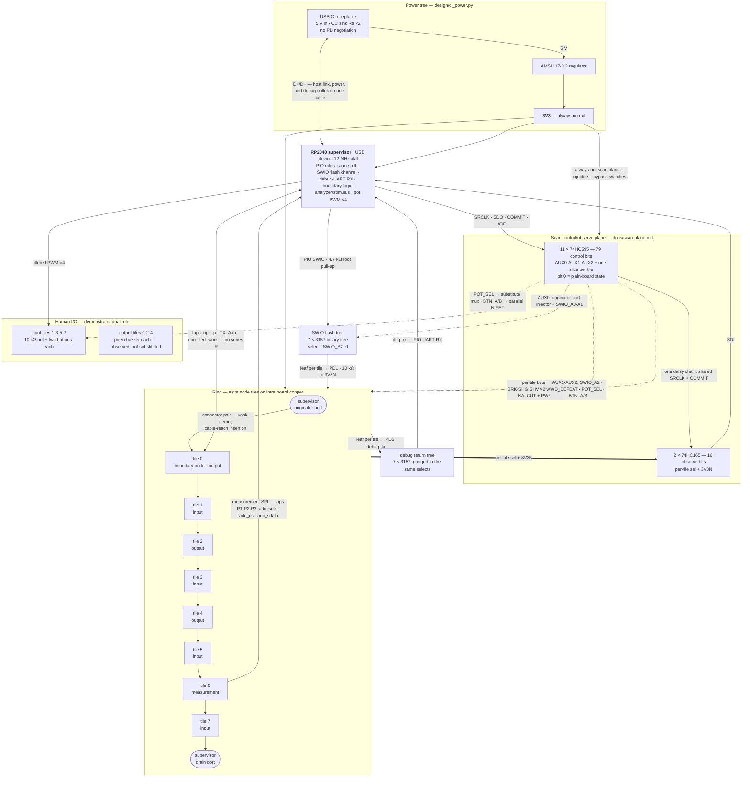
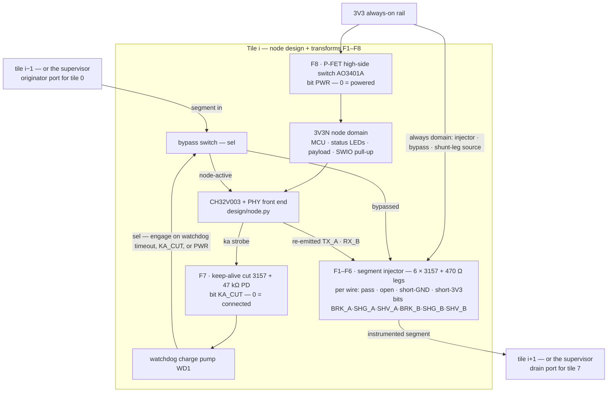

# CI board — block diagram

The whole CI board as blocks and the wires between them — one page, the
review artifact for the instrumentation / scan-plane / test-board
conversations. Drawn from [DESIGN.md §6](../DESIGN.md#6-test-board)
prose as a first pass; revised as those conversations settle, and
retired in favor of the DSL review views' generated block view once the
CI board capture exists. The sources of truth behind every block:
[docs/instrumented-ci.md](instrumented-ci.md) (fault injection,
overrides, taps, transform list), [docs/scan-plane.md](scan-plane.md)
(chain topology, bit maps, POR discipline, SWIO trees),
[design/ci_power.py](../design/ci_power.py) (power tree). Where this
diagram and a source disagree, the source wins — fix the diagram.

## Board level

Every inter-tile hop but one is an instrumented segment: the upstream tile's
injector sits at its downstream boundary on the segment's two wires
(`TX_A`, `RX_B`), so eight of the ring's nine segments are instrumented at
exactly one end — the supervisor's originator port carries one of the
eight (driven from AUX0); the exception is tile 6's downstream hop: tile
6 is the measurement tile
([instrumented-ci.md §12](instrumented-ci.md#12-tile-power-measurement-chain))
and carries no injector. Solid arrows are signal or power flow, dotted arrows
are scan-chain control, the thick arrow is observe.

## Tile anatomy

One tile, its rail split, and its per-tile transform set
(instrumented-ci.md §7, F1–F8 — declared once, instanced seven times;
the measurement tile carries the extended F8 only):

Per-role additions on top of the per-tile set:

- **Tile 0 (boundary node, designated debug DUT)** — four taps to RP2040
  GPIO (`opa_p`, `TX_A#b`, `opo`, `led_work`; PIO logic analyzer /
  stimulus, no series resistors) and the watchdog-defeat shunt
  (`WD_DEFEAT`, bit 0 = watchdog in charge) so a halted or single-stepped
  node stays electrically in the ring. It is an output tile.
- **Input tiles 1·3·5·7** — pot wiper through a `substitute` mux to PD6
  (`POT_SEL`: human pot ↔ supervisor filtered PWM) and each button
  paralleled by a 2N7002 N-FET (`BTN_A`/`BTN_B`, bit 0 = released).
- **Output tiles 0·2·4** — buzzer payload (PC4 → 470 Ω → piezo);
  observed through the node's telemetry, no control bits.
- **Tile 6 (measurement)** — the
  [§12 power-measurement chain](instrumented-ci.md#12-tile-power-measurement-chain)
  in place of the injector/keep-alive set and the buzzer payload: the
  extended F8 (82 mΩ shunt downstream of the power-cut FET, INA241A5
  mid-rail amp, ADCS7476 SPI ADC on the always-on 3V3), its SPI escaping
  on taps P1–P3 to supervisor GPIO0/1/2.
- **Supervisor originator port** — the same six-switch injector as a
  tile's on the supervisor→tile-0 segment (AUX0 bits 0–5); the drain
  port needs none — tile 7's injector covers that segment.

## Properties the diagram flattens

- **POR is a constructed all-zeros.** The 595 storage register has no
  silicon POR state: `/OE` pulled up, a 47 kΩ pull-down on every control
  line, and a zero-load boot sequence make bit-0 = plain board hold from
  power-on — an unpowered or hung supervisor leaves a plain board
  ([scan-plane.md §4](scan-plane.md#4-power-on-reset-the-constructed-zero-state-proof-input)).
  Those levels are the reset-state equivalence proof's inputs.
- **Observe lags control by one transaction** — the capture edge
  precedes the latch edge within a transaction
  ([scan-plane.md §1](scan-plane.md#1-architecture-one-daisy-chain)).
- **Every latched bit pattern is electrically safe** — the 470 Ω shunt
  legs bound all 79 bits' combinations, so the chain needs no hardware
  interlocks
  ([instrumented-ci.md §2](instrumented-ci.md#2-the-segment-injector)).
- Bit maps live in [scan-plane.md §3](scan-plane.md#3-bit-maps); the
  transform list this diagram summarizes lives in
  [instrumented-ci.md §7](instrumented-ci.md#7-the-transform-list).
